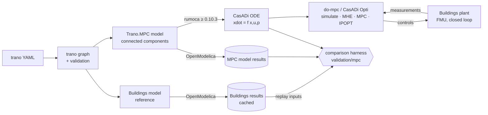
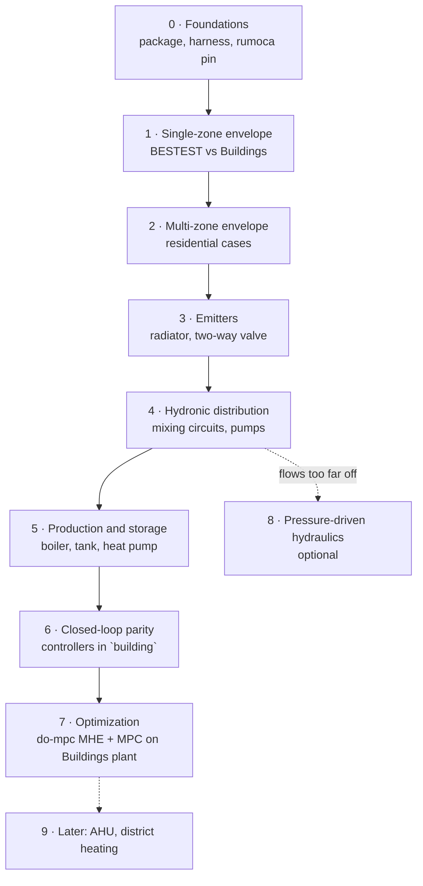

# Plan: `Trano.MPC`, a connectable library for optimization (Phase 2)

*Drafted 2026-10-13, from the findings of [`PRIOR_ART.md`](PRIOR_ART.md).*

## Goal

Build `Trano.MPC`, a component library that trano connects the way it connects Buildings models today, and that
turns into a CasADi model for **simulation, estimation and MPC with IPOPT**. The library is built incrementally:

1. start with a small envelope model;
2. stop at every stage to compare with the Buildings model that trano generates from the same YAML;
3. end with the **hydronic system** (boiler or heat pump, storage, mixing circuits, pumps, radiators and valves)
   running in an MPC loop.

### Definition of done

For the hydronic test buildings (`three_zones_hydronic.yaml`, the mixing circuit of
`docs/tutorials/hydronic_mixing_circuits.md`, `house_infiltration_air_water_heat_pump.yaml` and the two residential
reference cases):

- `trano create-model <yaml> mpc` produces a connected `Trano.MPC` model that:
  - rumoca exports to a CasADi ODE;
  - OpenModelica compiles and simulates;
- the model stays within the accuracy limits of the [validation section](#how-close-to-buildings) against the
  Buildings model of the same YAML;
- do-mpc runs on it, with moving-horizon estimation and economic MPC, and controls the **Buildings model as the
  plant** in closed loop.

### Starting point (already verified)

- Connected models give exactly the flat `building_mpc` results: same OCP objective, estimates and simulation
  (PRIOR_ART section 1b).
- Connected envelope prototype: [`prior_art/Light.mo`](prior_art/Light.mo).
- **Hydronic spike** ([`prior_art/LightHydronics.mo`](prior_art/LightHydronics.mo)): boiler → three-way mixing
  valve → pump → two radiator branches with two-way valves → return split, connected with a `WaterPort`.
  - rumoca main exports it to a CasADi ODE: 5 states, 76 algebraic variables eliminated.
  - After 24 h, its CVODES simulation matches OpenModelica to **8 × 10⁻⁵ K**.
  - **Full CasADi + IPOPT chain verified on it.** Controls: boiler heat, three-way valve and two radiator valves.
    - 24 h economic OCP: optimal in 99 iterations. Replayed through CVODES, the plan keeps the zones in 20.0–21.25 °C
      and the boiler at or below 90 °C.
    - 24 MPC re-solves: all optimal, warm solves 2.2 s on average with SX expansion.
    - Batch estimation of the radiator UA and zone capacities from noisy temperatures: 1.1999 / 0.8494 (true
      1.2 / 0.85).
  - pymoca fails on it (package-level constant), so **the hydronic stages need rumoca ≥ 0.10.3**.

## Architecture

**Two models from one YAML:**

- **`building_mpc`** contains the physics only: connected `Trano.MPC` components, smooth equations, all controls and
  disturbances as inputs. This is what rumoca exports.
- **`building`** is the runnable model. It feeds `building_mpc` with weather, solar gains, occupancy and the same
  controllers as the Buildings model. It may use events, since only OpenModelica simulates it.

Both exist today. What changes is that `building_mpc` becomes connected components instead of a flat equation list.

## Design rules (from PRIOR_ART, kept in every stage)

1. **Connectors.**
   - Use trano's own connectors: `HeatPort` (`T`, `flow Q_flow`) and `WaterPort` (`flow m_flow`, `T`). No MSL
     short-class connectors.
   - Water connectors join exactly two ports. Junctions are explicit components (`Splitter`, `Mixer`,
     `ThreeWayValve`), so the mixing temperature is computed explicitly and stream connectors are not needed.
2. **Nodes.**
   - Every node joined by `connect()` has a capacity, or its temperature is written in closed form inside its
     component.
   - rumoca rejects linear algebraic loops, such as a massless node between three resistors.
3. **Smoothness.**
   - No `if`, `when`, `min`, `max`, `abs` or tables in `building_mpc`.
   - Use smooth forms instead. Candidates, inspired by IBPSA `Utilities.Math.Functions.spliceFunction` and
     Buildings `regNonZeroPower`: softplus, `sqrt(x² + ε²)`, and a regularised power for the radiator exponent.
4. **Fixed flow direction.**
   - Water flows in the design direction from the YAML graph; trano already checks the layout
     (`HydronicLayoutWarning`).
   - Flows are set by the valves and the circuit pumps, not solved from pressures (stage 4).
   - Each closed hydraulic network has one `Reference` component, which drops the redundant mass balance. It plays
     the role of the `Boundary_pT` that trano's Buildings templates already contain.
5. **Parameters.**
   - Parameters are literal values on components, so they stay symbolic for estimation.
   - They are computed by trano from the YAML.
6. **Every component passes the toolchain gate** before it is merged:
   - rumoca exports it;
   - OpenModelica simulates it, and the two agree within 10⁻³ K on a unit test model;
   - an IPOPT problem on it converges.

## How close to Buildings

**Two comparison modes**, both run by a new harness `validation/mpc/`, built like `validation/bestest/`: cases,
cached Buildings runs, KPIs, a Markdown report and a `pytest -m mpc_validation` gate.

- **Replay (open loop): checks the physics.** Simulate the Buildings model and record the variables that are inputs
  of `building_mpc`:
  - weather and irradiance;
  - internal gains;
  - heating powers, or valve positions, three-way valve positions, pump flows and boiler or heat pump heat.

  Then feed them to `building_mpc` (rumoca → CasADi → CVODES) and compare the states. Controller differences cannot
  hide model errors in this mode.
- **Closed loop: checks the whole runnable model.** Simulate `building`, with trano's controllers, next to the
  Buildings model, and compare energy and comfort.

**Metrics.**

- Hourly temperatures: RMSE.
- Hourly heat flows: CV(RMSE) and NMBE, as ASHRAE Guideline 14 defines them for calibrated models (hourly limits
  CV(RMSE) ≤ 30 %, NMBE ≤ ±10 %).
- Annual or seasonal energy: relative deviation from Buildings.
- BESTEST cases: the ASHRAE 140 bands as well.

**Proposed thresholds** (to confirm, see [Decisions](#decisions-needed)):

| Stage | Compared outputs | Threshold vs Buildings |
|---|---|---|
| 1 envelope, single zone (BESTEST) | annual heating and cooling; free-floating temperature | inside the ASHRAE 140 band **and** within ±10 % of Buildings; hourly free-floating RMSE ≤ 1.0 K |
| 2 multi-zone envelope | zone temperatures (replay), zone heating energy | RMSE ≤ 0.5 K heated, ≤ 1.0 K free-floating; energy ±10 % per zone, ±5 % in total |
| 3 emitters | radiator heat output, return temperature | CV(RMSE) ≤ 15 %, NMBE ±5 %; return T RMSE ≤ 1 K |
| 4 distribution | supply and return temperatures, branch flows, zone temperatures | T RMSE ≤ 1 K; flow CV(RMSE) ≤ 15 %; zone RMSE ≤ 0.5 K |
| 5 production and storage | fuel or electricity, tank temperatures, COP | daily energy NMBE ±5 %; tank RMSE ≤ 2 K; mean COP ±5 % |
| 6 closed loop | seasonal energy, discomfort hours | energy ±5–10 %; discomfort hours ±10 % |

When a threshold is missed, first **fit the parameters to the Buildings output** with the estimation pipeline
(batch least squares, as in the PRIOR_ART benchmark). This tells us whether the structure or the parameter
derivation is wrong. Report both the physics-only and the calibrated results.

## Roadmap

Each stage is one or more PRs. A stage is done when its validation cases pass their thresholds in CI. Until then,
the previous generator path (flat `building_mpc`) stays the default.

| Stage | Size | Key deliverable | Exit gate |
|---|---|---|---|
| 0 | S | `Trano.MPC` skeleton, comparison harness, rumoca-main CI job | connected `three_zones_mpc` identical to the flat model; harness report on one case |
| 1 | M | VDI 6007 zone elements and parameters from the YAML | BESTEST 600, 900, 600FF, 900FF, 640, 940 within the thresholds |
| 2 | M | internal walls, floors, ground, ventilation, multi-zone | `two_zones`, `three_zones_ideal_heaters`, residential cases |
| 3 | M | `Radiator`, `Valve`, ideal supply | `radiator.yaml`, `single_zone_hydronic.yaml` in replay |
| 4 | L | `WaterPort` network: splitter, mixer, three-way valve, pump, pipe, reference | `three_zones_hydronic.yaml`, mixing circuit, `house_complex_dedicated_pumps.yaml` in replay |
| 5 | L | boiler, stratified tank, heat pumps, chiller, DHW, PV, battery, EV | boiler and heat pump cases in replay |
| 6 | M | trano controllers in the runnable model | closed loop over a heating season |
| 7 | L | do-mpc adapter, MHE, economic MPC, FMU co-simulation | 2-week closed-loop MPC on the Buildings plant |
| 8 | L (optional) | pressure-driven flows (DAE) | only if stage 4 flow errors exceed the threshold |

Sizes: S ≈ 1 week, M ≈ 2–3 weeks, L ≈ 4–6 weeks of focused work.

## Stages

### Stage 0: Foundations

- **Library source.** `trano/data/mpc/Trano/MPC/*.mo` holds a real, versioned Modelica package, so it can be tested
  on its own. It is embedded into the generated package as `Trano.MPC` is today. Start from
  [`prior_art/Light.mo`](prior_art/Light.mo):
  - `Interfaces`: `HeatPort`, `WaterPort`;
  - `Thermal`: `Capacitor`, `Resistor`, `Conductor`;
  - `Sources`: `PrescribedTemperature`, `FixedTemperature`, `HeatFlow`, `Solar`.
- **Generator.** A `connected` option of the `mpc` library writes `building_mpc` as components plus `connect()`
  statements. It goes through the same `Network` and Jinja machinery as the other libraries; the flat output stays
  the default.
- **rumoca.** Pin the tested main commit (`33c2114`) as an optional extra or a CI-only dependency, next to the
  released 0.10.x. Add a test that the connected and flat models have the same right-hand side, which was verified
  in PRIOR_ART.
- **Harness `validation/mpc/`.** Reuses the BESTEST pieces:
  - cases (YAML) and cached Buildings runs (OpenModelica Docker image);
  - a replay runner (Buildings result → `building_mpc` inputs → CasADi/CVODES);
  - KPIs (RMSE, CV(RMSE), NMBE, energy deviation) and the report.
- **CI.** For every library component, a unit model checks rumoca export, OpenModelica simulation and the
  rumoca/OpenModelica agreement.
- **Exit.** Connected `three_zones_mpc` identical to the flat model; the harness report runs on
  `three_zones_ideal_heaters.yaml` with today's R3C2 zones, which gives the **baseline gap** to Buildings.

### Stage 1: Single-zone envelope, close to Buildings

**Inspiration:**

- IBPSA `ThermalZones.ReducedOrder.RC.TwoElements` and its walls, `RC.BaseClasses.ExteriorWall` and
  `InteriorWall`;
- `EquivalentAirTemperature.VDI6007` for outdoor temperature, sky radiation and solar on opaque walls;
- the VDI 6007 aggregation of TEASER, a Python library usable as the reference implementation;
- IBPSA `ISO13790.Zone5R1C.Zone` for the simple variant.

**Components:**

- `AirNode` (air plus furniture capacity);
- `ExteriorWall` and `InteriorWall` (n-element RC chains, n = 1–3);
- `Window` (direct gain split into convective and radiative);
- `EquivalentOutdoorTemperature` (smooth, linearised long-wave);
- `Infiltration` (conductance from the air change rate);
- `RadiativeExchange` (linearised star node with explicit closed form, so no massless loop).

**Zone templates:** `VDI6007TwoElements` (new default), `R1C1`, `R3C2`, `R4C3` and `ISO13790` (kept).

**Parameters:**

- Compute them from the trano constructions with the VDI 6007 algorithm.
- Check them against TEASER for the same walls (unit test).
- Reconcile with `trano.mpc.estimation`.

**Inputs:** irradiance per orientation, as today, computed in `building` with the Buildings irradiance blocks, so
solar inputs are identical in both models.

**Validation:** BESTEST 600, 900, 600FF, 900FF, 640, 940. Buildings results are already cached by
`validation.bestest`. Use replay for free-floating cases, and the ideal dual set point controller of the runnable
model for loads.

**Risk:** BESTEST shading cases (610, 910) and sun-space are out of scope until shading is precomputed as an input.

### Stage 2: Multi-zone residential envelope

**Inspiration:** IBPSA `RC.FourElements` (floor and roof elements), the ISO 13370 ground model trano uses with IDEAS,
and the adiabatic party wall of the residential cases.

**Components:**

- `InteriorWall` between zones (two-sided);
- floors and ceilings between storeys;
- `GroundSlab` (ISO 13370 equivalent conductance plus slab capacity);
- `AdiabaticWall`;
- `Ventilation` (supply air with heat recovery efficiency as a conductance);
- occupancy gains from the existing models, split into convective and radiative.

**Generator:** one zone per space, walls connected between zones as trano connects internal elements for Buildings.

**Validation:**

- `two_zones.yaml`, `three_zones_ideal_heaters.yaml`, `house.yaml`;
- **`examples/residential_before_renovation.yaml`** and **`examples/residential_after_renovation.yaml`**
  (six zones);
- replay with the heating power of Buildings, plus loads with the ideal heaters.

### Stage 3: Emitters

**Inspiration:**

- Buildings and IDEAS `Fluid.HeatExchangers.Radiators.RadiatorEN442_2` (power law `Q = Q_nom (ΔT/ΔT_nom)^n`,
  `nEle` elements, `fraRad` split);
- AixLib `Radiator`;
- Buildings `Actuators.BaseClasses.equalPercentage` for the valve characteristic.

**Components:**

- **`Radiator`**:
  - 1–3 water/metal nodes;
  - heat to the room `Q = UA_eff · ΔT · (ΔT² + ε²)^((n−1)/2)`, a regularised EN 442 power law that is smooth at
    ΔT = 0;
  - convective share to the air node, radiative share to the wall node.
  - **Variant**: the outlet temperature in closed form, `T_out = T_room + (T_in − T_room)·exp(−UA/(ṁ c_p))`, which
    is accurate at low flow.
  - Choose `nEle` by comparing with Buildings `nEle = 5`.
- **`Valve`**: equal-percentage or linear with leakage, smooth, setting the branch flow
  `ṁ = ṁ_nom · φ(y)`.
- **`IdealSupply`**: prescribed supply temperature and flow, used for replay.

**Validation:** `radiator.yaml`, `single_zone_hydronic.yaml` (and its variants), replaying the supply temperature,
flow and valve position from Buildings.

### Stage 4: Hydronic distribution, the core of the goal

**Inspiration:**

- the trano Buildings templates (`TwoWayEqualPercentage`, `ThreeWayEqualPercentageLinear`, `FlowControlled_dp`
  pumps, split valves, `Boundary_pT`);
- MSL `Thermal.FluidHeatFlow`, a light thermo-fluid library whose structure is useful, but whose flow-reversal
  events must be dropped;
- mesido / rtc-tools-heat-network, which models district heating with fixed directions and set flows for
  optimization.

**Components:**

- `Splitter`, `Mixer` (explicit mixing temperature, regularised for zero flow);
- `ThreeWayValve` (mixing, share `y` of the outlet flow from the supply port);
- `Pump` (pass-through; electrical power of a constant-dp pump, `P = Δp·V̇/η(V̇)`);
- `Pipe` (optional water capacity and heat loss);
- `TemperatureSensor` and `HeatMeter` (outputs);
- `Reference` (one per closed network).

All of these are in the spike except `Pipe`, the sensors and the meter.

**Flow formulation (decision 2):**

- Branch flows are set by their valves, `ṁ = ṁ_nom · φ(y)`.
- Circuit flows follow from mass balances.
- This is exact when the pump holds the pressure difference, which is what trano's Buildings models do with
  `FlowControlled_dp`.
- The harness measures the error this causes by comparing branch flows with Buildings. Stage 8 exists only if that
  error exceeds the threshold.

**Generator:**

- Map the YAML hydronic graph (pumps, valves, three-way valves, split valves, sensors, radiators) to components.
- Put one `Reference` where the Buildings model has its `Boundary_pT`.
- Refuse, or warn about, diverting three-way valve layouts. trano already detects them; their mixing behaviour is
  wrong anyway (see the mixing tutorial).

**Validation, in replay:**

- `three_zones_hydronic.yaml`;
- the mixing-circuit model of `docs/tutorials/hydronic_mixing_circuits.md`;
- `house_complex_dedicated_pumps.yaml`, `house_complex.yaml`.

**Risk:**

- The bilinear `ṁ · T` terms make the OCP non-convex. Plan good initial guesses: warm start from a replay or a
  simulation.
- Small water volumes make the model stiff. Implicit integrators and collocation handle that; do not use explicit
  RK4 with large steps.

### Stage 5: Production and storage

**Inspiration:**

- Buildings `Boilers.BoilerPolynomial` (same efficiency polynomial, which is smooth);
- Buildings `Storage.StratifiedEnhanced` and MoSDH storage (n-node stratified tank);
- Buildings `HeatPumps.EquationFitReversible`: **reuse the exact biquadratic curves of the EnergyPlus data record
  trano already uses**, so the COP is identical;
- Buildings `HeatPumps.Carnot_TCon` as the generic fallback;
- the existing `trano.mpc.systems` (heat pump COP map, chiller, DHW tank, battery, EV, PV), turned into components.

**Components:**

- `Boiler` (water volume, heat input as control, efficiency polynomial, fuel power output);
- `Tank`:
  - n nodes, with smooth upwinding of the net flow per node, since the boiler and distribution loops make it change
    sign;
  - start with a fully mixed tank, then n = 3–5;
- `HeatPump` (water node, compressor power as control, `Q = COP(T_src, T_sup) · P`);
- `Chiller`, `DHWTank`;
- an `ElectricPort` (`flow P`) for `PV`, `Battery`, `EVCharger` and the grid connection.

**Validation:**

- `three_zones_hydronic.yaml` (boiler and tank);
- `house_infiltration_air_water_heat_pump.yaml`, `three_zones_hydronic_reduced_orders_heat_pump.yaml`;
- `house_mpc_systems.yaml`.

### Stage 6: Closed-loop parity

- Port trano's controllers into the runnable `building` model: emission control on zone temperature, three-way
  valve supply temperature control, boiler control, collector control. The runnable model may use events.
- `building_mpc` stays free of controllers.
- **Validation:** closed loop over a heating season against Buildings, for the residential cases (before and after
  renovation) and `three_zones_hydronic.yaml`.

### Stage 7: Optimization on the hydronic model

- **do-mpc adapter**:
  - interface v3 describes the hydronic controls (`QBoi` or `PHeaPum`, `yMix`, `y_i`, pump flows) and their bounds;
  - set both `bounds` and `terminal_bounds` (PRIOR_ART section 1);
  - export to SX for do-mpc.
- **MHE**: zone and water temperatures; parameters such as capacity scales, radiator `UA` and tank losses.
- **Economic MPC**: time-of-use price, comfort bands, supply temperature limits.
- **Targets**: three-zone hydronic, 48 h horizon at 15 min, first solve < 10 s, warm solve < 2 s.
- **Closed loop on the Buildings plant**:
  - export the Buildings model of the same YAML as an FMU with OpenModelica;
  - run it with FMPy;
  - the MPC sets the controls;
  - compare with the PI baseline over 2 weeks: energy cost, discomfort, controls.

### Stage 8 (optional): Pressure-driven hydraulics

Only if stage 4 flow errors exceed the threshold, for example circuits without differential pressure control.

**Options:**

- pressure–flow network as a DAE, solved with do-mpc algebraic states, at the speed cost seen with rtc-tools;
- a smooth surrogate of each branch flow as a function of all openings, fitted on Buildings runs.

### Later

- AHU, VAV and ventilation (air side);
- district heating (mesido formulation);
- shading precomputation for BESTEST 610/910.

## What we borrow, component by component

| `Trano.MPC` component | Borrowed from | Changed for optimization |
|---|---|---|
| `ExteriorWall`, `InteriorWall`, zone templates | IBPSA `ReducedOrder.RC`, VDI 6007, TEASER parameters | own `HeatPort`; no conditional components; parameters from the YAML |
| `EquivalentOutdoorTemperature` | IBPSA `EquivalentAirTemperature.VDI6007` | smooth, linearised long-wave; irradiance as inputs |
| `Zone5R1C` variant | IBPSA `ISO13790.Zone5R1C.Zone` | closed-form surface node (no massless loop) |
| `Radiator` | Buildings / IDEAS `RadiatorEN442_2`, AixLib `Radiator` | regularised power law; closed-form outlet; 1–3 nodes |
| `Valve`, `ThreeWayValve` | Buildings `equalPercentage`, `ThreeWayEqualPercentageLinear` | set flows instead of pressure–flow; smooth characteristic |
| `Pump` | Buildings `FlowControlled_dp` | pass-through; power from constant Δp and an efficiency curve |
| `Splitter`, `Mixer`, `Reference` | MSL `FluidHeatFlow`, Buildings `Boundary_pT` | fixed direction; explicit mixing; one reference per network |
| `Boiler` | Buildings `BoilerPolynomial` | same polynomial; heat input as control |
| `Tank` | Buildings `StratifiedEnhanced`, MoSDH storage | n nodes, smooth upwinding |
| `HeatPump` | Buildings `EquationFitReversible` (same curves), `Carnot_TCon` | compressor power as control |
| `PV`, `Battery`, `EVCharger`, `DHWTank`, `Chiller` | existing `trano.mpc.systems`, OCHRE, HiSim | components with an `ElectricPort` |

## Decisions needed

1. **rumoca dependency.**
   - **Recommended:** pin the tested main commit now, because the hydronic stages need it (pymoca fails on them).
   - Alternative: wait for 0.10.3 and start with stages 1–3, which also work with pymoca.
2. **Flow formulation.**
   - **Recommended:** valve-set flows (constant Δp) first, with pressure-driven flows only if the measured error
     requires them.
3. **Accuracy thresholds:** the table above. Is ±10 % per zone / ±5 % total energy the right bar against Buildings?
4. **Default zone model** of the `mpc` library after stage 1: VDI 6007 two elements (recommended, closest to
   Buildings) or keep R3C2.

## Risks

| Risk | Mitigation |
|---|---|
| rumoca main is unreleased and alpha | pin a commit; CI also compiles every model with OpenModelica; equivalence tests catch export errors |
| Stiff hydronics (small water volumes) | implicit integrators (CVODES), collocation in do-mpc; lump small volumes |
| Non-convex OCP (`ṁ · T`) | warm start from replay; smooth formulations; bounded flows |
| Tank flow reversal | smooth upwinding; start fully mixed |
| Constant-Δp flow assumption | measured in stage 4; stage 8 as fallback |
| Validation runtime (Buildings runs take minutes) | cache Buildings results per generated model, as `validation/bestest` does |
| Divergence between the two models' parameters | same YAML → same parameter code path; unit tests per component against the Buildings component on a tiny model |
