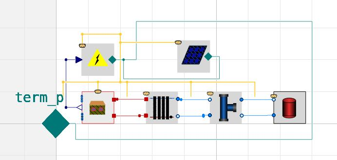

# 🔥 Trano: Automated Building Energy Simulation (BES) Model Generation 🚀

📖 **Full Documentation:** 👉 [Trano Docs](https://andoludo.github.io/trano/) 

---
**Trano** is an innovative Python package that automates the creation of complex **Building Energy Simulation (BES)** Modelica models from simplified information contained in widely used data formats like **YAML, JSON, or RDF**. Unlike traditional tools that directly convert **BIM** to **BES**, Trano introduces an intermediate step, paving the way for seamless integration with **IFC translators**.  

Trano is **Modelica library agnostic** but is natively designed to work with:  
✅ **Validated detailed Modelica libraries** (e.g., **[Buildings](https://github.com/lbl-srg/modelica-buildings)**, **[IDEAS](https://github.com/open-ideas/IDEAS)**,...)  
✅ **Reduced-order models** (e.g., **[AIXLIB](https://github.com/RWTH-EBC/AixLib)**, **ISO13790**,...)  
✅ **Models for optimal control** (**[FastModel](https://andoludo.github.io/trano/reference/fast_model/)**: close to Buildings, closed loop or for optimal control, translated to CasADi)  
✅ **your library...**  

## 🧪 Supported libraries and validation

| Library | Version | Zone model | Role |
|---|---|---|---|
| [Buildings](https://github.com/lbl-srg/modelica-buildings) | 13.0.0 | `Buildings.ThermalZones.Detailed.MixedAir` | detailed, validated |
| [IDEAS](https://github.com/open-ideas/IDEAS) | 3.0.0 | `IDEAS.Buildings.Components.Zone` | detailed, validated |
| [AixLib](https://github.com/RWTH-EBC/AixLib) reduced order (`reduced_order`) | 3.0.1 | `AixLib.ThermalZones.ReducedOrder.ThermalZone` | simplified, informational |
| ISO 13790 (`iso_13790`) | AixLib 3.0.1 | `ISO13790.Zone5R1C` | simplified, informational |
| `FastModel` | - | `FastModel.Zones.Zone` (the physics of `MixedAir`), with the hydronic and ventilation systems and their controllers | close to Buildings, closed loop, CasADi ready |
| `FastModelMPC` | - | the same, the controls of the systems as inputs | optimal control, CasADi ready |

The HVAC components (radiators, valves, pumps, boilers, heat pumps, air handling units) come from the Buildings
library for every Modelica library. The Modelica name of every parameter in every library is listed in the
[parameter reference](https://andoludo.github.io/trano/reference/parameters/).

The models trano generates are **validated against ASHRAE Standard 140 (BESTEST)**: the 27 single-zone cases
are simulated for a year with every library and compared with the acceptance limits of the standard and the
spread of the reference programs. Buildings and IDEAS pass every case (see the
[validation results](https://andoludo.github.io/trano/validation/bestest/) and the
[walk through the cases](https://andoludo.github.io/trano/validation/bestest_cases/)); the two simplified
zones are reported for information. Simulations run in the official OpenModelica image.

## ✨ Key Features

### 🛠️ **Built for Open-Source BES**
- Designed with **widespread adoption** in mind.
- **Optimized for OpenModelica**, but also compatible with **Dymola**.

### 🔥 **Full Thermal & Electrical Modeling**
- Generates both **thermal** and **electrical** models.
- Supports **building envelope, systems, and electricity**.
- Models:
  - **Envelope** (geometry & materials) 🏢  
  - **HVAC systems** (emission, hydronic distribution, boilers) ❄️🔥  
  - **Electrical components** (PV systems, electrical loads) ⚡  

### 🎨 **Easy to Use & Modify**
- Generates **graphical representations** of components & connections 🎭.

- Fully **modular design** for seamless modifications:
  - **Envelope** 🏠
  - **Emission** 💨
  - **Hydronic Distribution** 🚰
  - **Production & Electricity** ⚡  

### 🧩 **Extensible Component Variants**
Every Trano component (radiator, space, control, AHU, boiler, ...) is selected
by a **variant** name — switching `variant: default` to `variant: ideal`
swaps the underlying Modelica model. You can also drop your own variant
YAML files into any folder and load them via the CLI (`--variants-folder`),
the Python API (`register_variants_folder`), or the `TRANO_VARIANTS_PATH`
environment variable.

📚 **Tutorial:** [Creating and using component variants](https://andoludo.github.io/trano/tutorials/component_variants/)

### 🎛️ **Models for optimal control**
- `FastModel` library: `trano create-model house.yaml FastModel` generates a model **close to Buildings** (layered walls, windows with their angular optics, long-wave and solar exchanges in the rooms, radiators, valves, boilers, heat pumps, ventilation with heat recovery, PV) that **rumoca translates to a CasADi ODE**. `FastModel` simulates the building in **closed loop** with its controllers and pressure-driven water circuits; `FastModelMPC` leaves the controllers out, so that `trano_optimization` (the [trano-optimization](https://github.com/andoludo/trano-optimization) package, installed next to trano) decides the controls: it simulates the model, estimates its state and solves optimal control problems with IPOPT. In closed loop, FastModel follows Buildings within 0.05–0.39 K on the zone temperatures (0.05–0.25 K with controlled heating) (see the [FastModel reference](https://andoludo.github.io/trano/reference/fast_model/)).

🚀 **With Trano, creating and modifying detailed BES models has never been easier!**  

---

📖 **Full Documentation:** 👉 [Trano Docs](https://andoludo.github.io/trano/) 

## 📄 License

Trano is released under the [Apache License 2.0](https://github.com/andoludo/trano/blob/master/LICENSE). Releases up to and including 0.56.0 were published under the LGPL-3.0-or-later.
