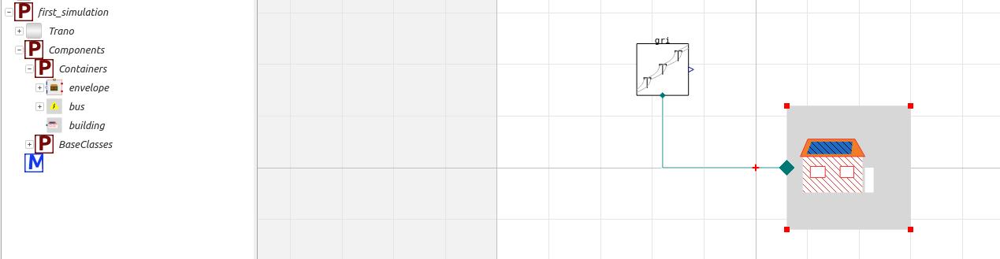
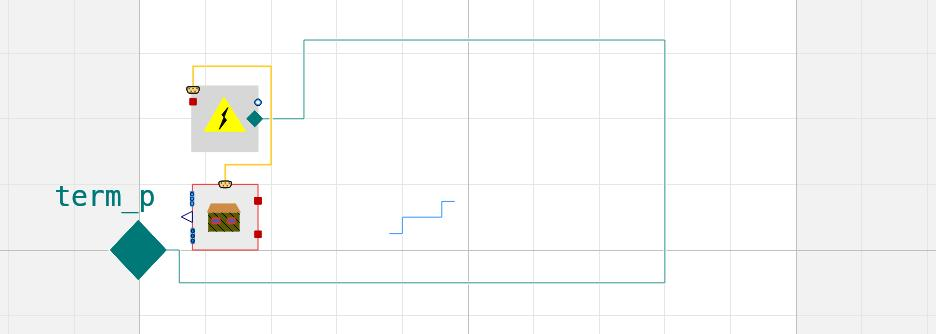
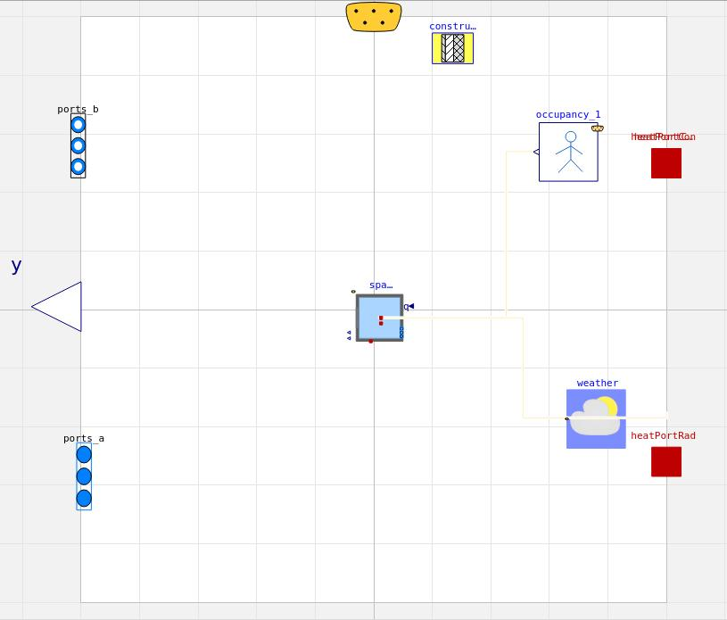

# First model and simulation
This tutorial will guide you in creating and simulating your first Building Energy Simulation model in Modelica using the Trano library. All you need is a configuration file and a few lines of code. This introductory tutorial demonstrates the simplicity of running building energy simulations with Trano, showcasing how to browse and modify the model using OpenModelica. Alternatively, you can run the simulation directly through Trano with the official OpenModelica Docker image. Additionally, Trano features automatic report generation for key parameters.

## Input configuration file

The following file describes a single-zone house: 100 m2 of floor (12.5 m by 8 m, 2.5 m high) with a
large south-facing window and a small north one, brick and insulation walls, an insulated flat roof
and a slab on the ground. The house is occupied in the morning and in the evening, infiltrates 0.5 air
changes per hour, and an ideal heating and cooling system keeps it between a heating set point of 21 degC
by day (18 degC at night) and a cooling set point of 26 degC.

A few conventions of the file:

- **Materials and constructions**: a construction is a list of layers from the outside to the inside, each
  layer being a material and a thickness. The glazing is described the same way with glass panes and gas gaps,
  and trano computes the U-value and the g-value of the glazing from its layers.
- **Orientation**: azimuths are in radians, 0 being south, positive towards the west (1.5708 is west,
  3.1416 north, -1.5708 east). A wall's `surface` is the gross area of the facade: the windows facing the
  same way are cut out of it, so the window area must not be subtracted from the wall. The flat roof is an
  external wall with the `ceiling` tilt.
- **Zone**: the `infiltration` variant takes the air change rate `ach`; the occupancy table lists the
  times at which the zone switches between occupied and unoccupied (7:00 to 9:00 and 18:00 to 23:00 here);
  the ideal system takes day schedules of set points in kelvin (rows of time since midnight in seconds and
  set point) and its capacities.

Every parameter is optional: a parameter left out takes the default of the library the model is generated
for (see the [parameter reference](../reference/parameters.md)).

```yaml
# A single-zone house of 100 m2 (12.5 m by 8 m, 2.5 m high) with a south-facing living room window,
# brick and insulation walls, an insulated flat roof and a slab on the ground. It is occupied in the
# morning and in the evening, infiltrates 0.5 air changes per hour and is kept between a heating set
# point (21 degC by day, 18 degC at night) and a cooling set point (26 degC) by an ideal system.
material:
  - id: BRICK:001
    thermal_conductivity: 0.9
    density: 1900.0
    specific_heat_capacity: 840.0
  - id: INSULATION:001
    thermal_conductivity: 0.035
    density: 30.0
    specific_heat_capacity: 1400.0
  - id: CONCRETE_BLOCK:001
    thermal_conductivity: 1.1
    density: 1400.0
    specific_heat_capacity: 840.0
  - id: PLASTER:001
    thermal_conductivity: 0.4
    density: 1000.0
    specific_heat_capacity: 1000.0
  - id: CONCRETE:001
    thermal_conductivity: 1.4
    density: 2100.0
    specific_heat_capacity: 840.0
  - id: ROOFING:001
    thermal_conductivity: 0.23
    density: 1100.0
    specific_heat_capacity: 1000.0

constructions:
  - id: EXTERNAL_WALL:001
    layers:
      - material: BRICK:001
        thickness: 0.09
      - material: INSULATION:001
        thickness: 0.12
      - material: CONCRETE_BLOCK:001
        thickness: 0.14
      - material: PLASTER:001
        thickness: 0.015
  - id: FLAT_ROOF:001
    layers:
      - material: ROOFING:001
        thickness: 0.01
      - material: INSULATION:001
        thickness: 0.16
      - material: CONCRETE:001
        thickness: 0.15
      - material: PLASTER:001
        thickness: 0.015
  - id: GROUND_FLOOR:001
    layers:
      - material: INSULATION:001
        thickness: 0.08
      - material: CONCRETE:001
        thickness: 0.15
glass_material:
  - id: GLASS:001
    thermal_conductivity: 1.0
    density: 2500.0
    specific_heat_capacity: 840.0
    longwave_emissivity: 0.84
    shortwave_emissivity: 0.67
gas:
  - id: ARGON:001
    thermal_conductivity: 0.017
    density: 1.66
    specific_heat_capacity: 520.0
    longwave_emissivity: 0.0
    shortwave_emissivity: 0.0
glazings:
  - id: DOUBLE_GLAZING:001
    u_value_frame: 1.4
    layers:
      - glass: GLASS:001
        thickness: 0.004
      - gas: ARGON:001
        thickness: 0.016
      - glass: GLASS:001
        thickness: 0.004
spaces:
  - id: LIVING:001
    variant: infiltration
    parameters:
      floor_area: 100.0
      average_room_height: 2.5
      ach: 0.5
    occupancy:
      parameters:
        occupancy: 3600*{7, 9, 18, 23}
    emissions:
      - ideal_heating_cooling:
          id: HEATING:001
          parameters:
            heating_setpoint_schedule: "[0, 291.15; 25200, 291.15; 25200, 294.15; 82800, 294.15; 82800, 291.15; 86400, 291.15]"
            cooling_setpoint_schedule: "[0, 299.15]"
            maximum_heating_power: 8000.0
            maximum_cooling_power: 4000.0
    external_boundaries:
      external_walls:
        - surface: 31.25
          azimuth: 0.0
          tilt: wall
          construction: EXTERNAL_WALL:001
        - surface: 20.0
          azimuth: 1.5708
          tilt: wall
          construction: EXTERNAL_WALL:001
        - surface: 31.25
          azimuth: 3.1416
          tilt: wall
          construction: EXTERNAL_WALL:001
        - surface: 20.0
          azimuth: -1.5708
          tilt: wall
          construction: EXTERNAL_WALL:001
        - surface: 100.0
          azimuth: 0.0
          tilt: ceiling
          construction: FLAT_ROOF:001
      floor_on_grounds:
        - surface: 100.0
          construction: GROUND_FLOOR:001
      windows:
        - surface: 12.0
          azimuth: 0.0
          tilt: wall
          construction: DOUBLE_GLAZING:001
          width: 6.0
          height: 2.0
        - surface: 4.0
          azimuth: 3.1416
          tilt: wall
          construction: DOUBLE_GLAZING:001
          width: 2.0
          height: 2.0
```

A space without an `occupancy` entry, or with an empty one, gets trano's default occupancy schedule
(35 W radiant, 70 W convective and 30 W latent per person, from 7:00 to 19:00). An unconditioned
space with no occupancy at all says so with `occupancy: {variant: none}`.

A window takes a few optional attributes: `frame_fraction` (share of the area taken by the frame, 0.1
when absent), an `overhang` and `side_fins`. The shading devices are given by their geometry in
metres: `depth` perpendicular to the wall, `gap` (distance between the window and the device),
`width_left` and `width_right` for the overhang and `height` above the window for the fins. They are
rendered for the Buildings library:

```yaml
      windows:
        - surface: 12.0
          azimuth: 0.0
          tilt: wall
          construction: INS2AR2020:001
          width: 6.0
          height: 2.0
          frame_fraction: 0.001
          overhang:
            depth: 1.0
            gap: 0.5
            width_left: 0.5
            width_right: 0.5
          side_fins:
            depth: 1.0
            height: 0.5
```

## Generate Modelica model


```python title='Test tutorials'
    from trano.main import create_model

    create_model(
        path_to_yaml_configuration_folder / "first_model.yaml",
    )

```
### Explanation

The code snippet imports the `create_model` function from the `trano.main` module and then calls this function with a specified YAML configuration file to create a model based on the parameters defined in that file.

### General Description and Parameters

- **Function**: `create_model`
- **Parameter**:
  - `path_to_yaml_configuration_folder / "first_model.yaml"`: 
    - Type: String (or path-like object)
    - Description: The path to the YAML file that contains configuration settings for the model being created.


The model is created in the same folder as the configuration file, with the extension .mo. In this case, the model is saved as `first_model.mo`. Provided that the necessary libraries, such as the Buildings library, are loaded, the generated model can be opened in OpenModelica, as illustrated in the figure below. Additionally, if not specified, Trano utilizes the Buildings library to generate the model.



If one opens the main building components, the generated components are subdivided into various sub-components, as illustrated below. The envelope sub-component holds the walls, the roof, the floor and the windows; the emission sub-component holds the ideal heating and cooling system.



Opening the envelope subcomponents reveals the various base components and information that constitute the building envelope model. At this stage, the user can modify the model as necessary.



## Simulate

The following code snippet can be used to directly simulate the model after its generation. The model will not be generated; instead, it will be simulated within the OpenModelica container.


```python title='Test tutorials'
    from trano.main import simulate_model

    simulate_model(
        path_to_yaml_configuration_folder / "first_model.yaml",
        library="Buildings",
        start=0,
        end=2 * 3600 * 24 * 7,
    )

```
### Explanation of Code Snippet
The code snippet imports a function `simulate_model` from the `trano.main` module and calls it to run a simulation using a specified YAML configuration file and parameters.

### General Description and Parameters
- **Function:** `simulate_model`
- **Parameters:**
  - `path_to_yaml_configuration_folder / "first_model.yaml"`
    - Path to the configuration file for the simulation.
  - `library`: `"Buildings"`
    - Specifies the library to be used for the simulation.
  - `start`: `0`
    - Start time for the simulation in seconds.
  - `end`: `2 * 3600 * 24 * 7`
    - End time for the simulation, calculated as two weeks in seconds.


Once the simulation is complete, trano writes a report next to the configuration file
(`first_model.html`). The figure below shows the air temperature of the zone over the two weeks of January: the ideal system holds it at the
21 degC set point by day and lets it fall towards 18 degC at night, and the solar gains through the south
window ease the heating on sunny afternoons. The lower panel shows the heat the ideal system releases.

{!tutorials/figures/first_model.html!}
